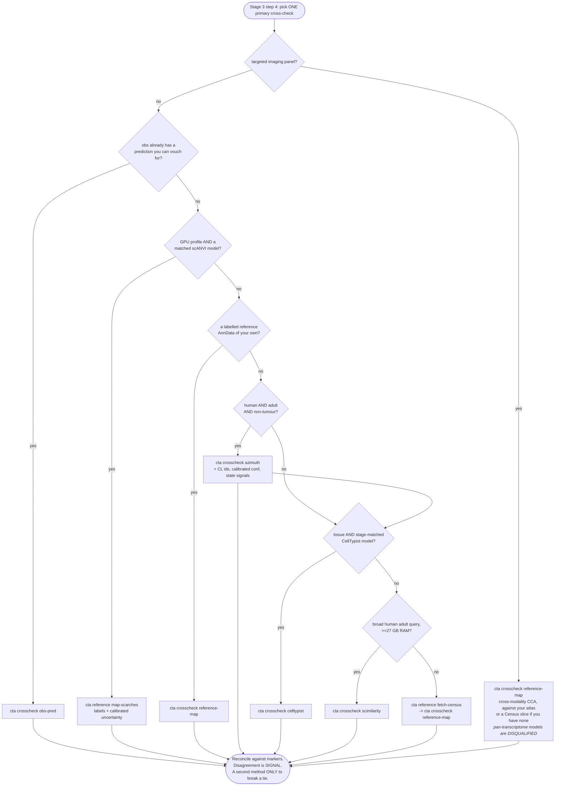

# Reference: Method selection — which cross-check, and when

**Claude + marker evidence is the annotator on every path in this document.** Everything routed
here is **one automated hypothesis to reconcile against the markers** — never a verdict, never a
silent overwrite (`reference/automated_tools.md`). Run **exactly one** primary cross-check; a
second only to break a tie. Gate A (assumptions ledger) and Gate B (honest `Unknown`) are
unchanged by which branch you take. Disagreement between a cross-check and the marker evidence is
**signal**, not error — it often marks the ambiguous progenitor / transitional states that matter
most.

## One definition, two renderings

The ranking and every gating condition live in **`src/cta/routing.py`** — as data, not prose.
Do not restate them anywhere:

- **Run `cta route`** (Stage 3 step 4) to get the answer for a specific query. It names the
  primary cross-check and says why every higher-ranked option was skipped or refused.
- **The tables below are GENERATED** from the same module by `cta route --emit-markdown`, between
  the marker comments. `tests/test_method_selection_sync.py` fails if this file drifts from what
  the module emits, exactly as `tests/test_registry_sync.py` polices the command surface.
- `reference/tool_registry.md` owns each tool's **cost** (GPU / RAM / profile);
  `reference/automated_tools.md` owns **why each method behaves as it does**. This file owns the
  **choice**. To change routing, edit `routing.py` and regenerate — never edit the block below.

```
cta route --species human --stage adult --state normal \
          --technology dissociated --profile local_cpu --ram-gb 32
```

## What this does NOT decide

- **Whether to run a cross-check at all.** You always do; the question is which one.
- **Whether its answer is right.** That is the marker evidence's job, then the critic pass.
- **The label vocabulary or the hierarchy.** Those come from the Stage-1 contract.
- **Cluster `state`.** Quality / cycling / doublet calls come from `cta data qc` +
  `cta cluster profile`; a cross-check can only *corroborate* a state, never set one.

## Reading the axes

Two of the six cannot be probed from the data and **must be established with the user in Stage 1**:
**stage** (adult vs developmental vs organoid) and **state** (normal vs disease vs tumour). They
gate the pan-body human models, and getting them wrong is the difference between a useful
hypothesis and confident nonsense — `cta route` warns when either is left `unknown`.

<!-- BEGIN GENERATED: cta route --emit-markdown -->
### The six axes

| Axis | Values | How you determine it |
| --- | --- | --- |
| **species** | `human` · `mouse` · `other` | Stage-1 intake (`context.md`); corroborated by the gene-ID convention in `cta data inspect`. |
| **stage** | `adult` · `developmental` · `organoid` · `unknown` | Stage-1 intake — there is NO data probe for this. Ask; do not infer from tissue. |
| **state** | `normal` · `disease` · `tumor` · `unknown` | Stage-1 intake for the design; `cta data qc` -> `cta cluster profile` for per-cluster quality/cycling. |
| **technology** | `dissociated` · `spatial_wt` · `spatial_panel` | `cta data inspect` reports a `targeted_panel` flag; confirm the platform with the user. |
| **profile** | `local_cpu` · `local_gpu` · `scheduler` | `cta detect-env`, then CONFIRM with the user (a scheduler on PATH is ambiguous). |
| **references** (flags) | `obs_pred` · `atlas` · `scanvi_model` · `celltypist_model` | `cta data inspect` obs listing; `cta crosscheck celltypist list --contains <tissue>`. |

### The ranking

Evaluated top-down. The first route whose preconditions hold **and** whose
disqualifiers are all false is the primary cross-check. A disqualifier beats rank.

| # | Cross-check | Use when | Why here |
| --- | --- | --- | --- |
| 1 | `cta crosscheck obs-pred` | `obs` already carries a prediction that fits this level | Free and already reconciled with the object — no recompute, no new assumptions. |
| 2 | `cta reference map-scarches` | a GPU profile AND a well-matched scANVI reference model (trained or from the hub) | The strongest option when it fits: labels WITH calibrated per-cell uncertainty, in a reference latent space built for this tissue. A well-matched, curated reference beats any generic model. |
| 3 | `cta crosscheck reference-map` | a labelled reference AnnData of your own (the user's atlas, or a Census slice) | The user's own curated atlas for their tissue/context is usually the strongest reference available (`reference/knowledge_sources.md`) — and CellMapper builds the joint embedding itself, including cross-modality CCA for a targeted panel. |
| 4 | `cta crosscheck azimuth` | human, adult/postnatal, non-tumour, whole-transcriptome — and no matched reference above | One supervised model spanning 23 human tissues, so a single reference covers a broad or multi-tissue query that no one tissue-specific model does. It is also the only cross-check here that returns a Cell Ontology id per cluster, a CALIBRATED confidence, and trained `Unassigned` / `Doublet like cell` classes that feed the `state` axis. CPU-only and cheap (~50-60k cells/min, 84 MB model), so it costs little to consult. |
| 5 | `cta crosscheck celltypist` | a tissue- AND stage-matched pretrained model exists (`celltypist list` first) | When a genuinely matched model exists it is a strong, nearly free cross-check trained on exactly this tissue. The gate is the whole point: stage matters as much as tissue, and a mismatched model collapses rather than degrading gracefully. |
| 6 | `cta crosscheck scimilarity` | broad / multi-tissue human adult query with no matched reference or model | A long-standing option for broad / multi-tissue human queries where no tissue-matched model exists. Kept below Azimuth because it costs far more (9 GB bundle, 16-27 GB RAM) and returns a flat label space with no ontology ids, no calibrated confidence and no state signals — not because either has been shown to annotate better. |
| 7 | `cta reference fetch-census -> cta crosscheck reference-map` | nothing above fits — build a reference instead of going without one | Keeps a reference cross-check alive for ANY species/tissue, so no level goes unchecked. |

### Disqualifiers (a hard refusal, whatever the rank)

| Cross-check | Refused when |
| --- | --- |
| `cta crosscheck obs-pred` | the existing column's provenance is unknown, or the method that produced it is itself disqualified here (species / stage / tissue / panel) |
| `cta reference map-scarches` | no CUDA GPU reachable from this process |
| `cta crosscheck reference-map` | fewer than MIN_SHARED_GENES shared genes after symbol alignment |
| `cta crosscheck azimuth` | non-human query (the model has a fixed human gene space); developmental / organoid query (trained on adult tissue; not designed for developmental stages); tumour expected (malignant cells were excluded from training); targeted imaging panel (missing panel genes are zero-filled, producing confident garbage) |
| `cta crosscheck celltypist` | no tissue- AND stage-matched model — OMIT CellTypist rather than force an ill-fitting one (a mismatched model collapses, it does not degrade gracefully); targeted imaging panel (most model genes missing) |
| `cta crosscheck scimilarity` | non-human query (the model has a fixed human gene space); developmental / organoid query (trained on adult tissue; not designed for developmental stages); tumour expected (malignant cells were excluded from training); targeted imaging panel (missing panel genes are zero-filled, producing confident garbage); under ~27 GB of usable RAM |
| `cta reference fetch-census -> cta crosscheck reference-map` | offline (Census is a remote TileDB store) |

### Caveats that travel with the result

- **`cta crosscheck obs-pred`** — It summarises SOMEONE ELSE'S prediction and silently inherits that method's disqualifiers. Establish what produced the column before trusting it; if you cannot, treat this route as unavailable.
- **`cta reference map-scarches`** — Stochastic — seed it and still report predictions as a hypothesis.
- **`cta crosscheck reference-map`** — On a targeted spatial panel this is the PREFERRED route (cross-modality CCA).
- **`cta crosscheck azimuth`** — Two structural limits to weigh its labels against. (1) It CANNOT be constrained to a tissue — it always predicts over the full pan-body space, so on a single-organ query it can return a type belonging to a different organ; check the winning label against the tissue in context.md. (2) Its training labels were transferred from tissue-specific references, and for lymph node and spleen those were the CellTypist organ atlases — so on immune tissue it is NOT an independent second opinion relative to CellTypist. Where a genuinely tissue- AND stage-matched CellTypist or scANVI model exists, treat that as the stronger reference and use it as the tie-break. Its CL ids, calibrated confidence and state signals are useful independently of how you weigh its labels.
- **`cta crosscheck celltypist`** — Scale-sensitive; `predict` rebuilds log1p-CP10K itself from the canonical counts.
- **`cta crosscheck scimilarity`** — Zero-shot foundation model — an additional opinion, never a primary annotator.
- **`cta reference fetch-census -> cta crosscheck reference-map`** — Census `cell_type` is author-supplied and heterogeneous across contributing datasets, so a transferred label is a coarser/noisier hypothesis than one from a single curated atlas — corroborating signal, not ground truth.

### The tree



*(The mermaid tree is a reading aid for the common path; `cta route` is authoritative —
both are generated from `src/cta/routing.py`.)*
<!-- END GENERATED -->

## Why the gates are where they are

The disqualifiers come from the **tool authors' own stated scope**, not from our own scoring.
Pan-human Azimuth's authors write that the model "was not designed to capture developmental
stages, disease-specific states, or cancer programs", while noting that non-cancer disease
usually still maps sensibly onto the nearest healthy identity; it is trained on human tissue
only. That is the basis for the species, stage and tumour disqualifiers. The targeted-panel
disqualifier is structural: `panhumanpy` zero-fills panel genes the query lacks, so a query
covering a small fraction of its 5,055-gene input space still returns confident labels.
SCimilarity's human-only gate is likewise a property of its fixed human gene order.

We do run these tools against annotated datasets internally to sanity-check the gates. That work
is **preliminary and unpublished**, so it is deliberately not quoted here as a performance
comparison, and nothing in this skill's ranking should be read as a benchmark result. The
ordering encodes a **preference** — a curated, tissue-matched reference outranks a generic one —
plus cost and what each tool returns beyond a label. It is not a claim that any tool annotates
better than another.

## Reading the model's own out-of-distribution signals

`cta crosscheck azimuth` writes `azimuth_state_<level>.csv`, and its diagnostics are a more
reliable guide than any axis you set by hand:

- **`frac_inconsistent_hierarchy`** — the fraction of cells whose 8 hierarchical heads did not
  agree on a self-consistent path. It rises markedly on out-of-distribution queries, so treat a
  high value as a warning that the query is outside the model's training distribution *whatever
  the axes said*, and do not let the cross-check drive a fine call for that cluster.
- **`frac_unassigned`** — a trained class for low-quality/ambient and mixture profiles.
- **mean calibrated confidence** — temperature-scaled, so readable as an actual probability.

Note that gene coverage is usually *not* the tell: ortholog mapping can keep panel overlap high
on a non-human query while the biology is still unrecognised. Judge by the diagnostics above, not
by panel overlap alone.

## Where to look next

| Question | File |
| --- | --- |
| What does this tool cost (GPU / RAM / profile)? | `reference/tool_registry.md` |
| Why does this method behave the way it does? What is deliberately skipped? | `reference/automated_tools.md` |
| Which compute profile am I on, and how do heavy steps execute? | `reference/compute_environments.md` |
| How do I weigh a cross-check against the markers? The two gates? | `reference/methodology.md` |
| Which reference/atlas should I even be pointing at? | `reference/knowledge_sources.md` |
